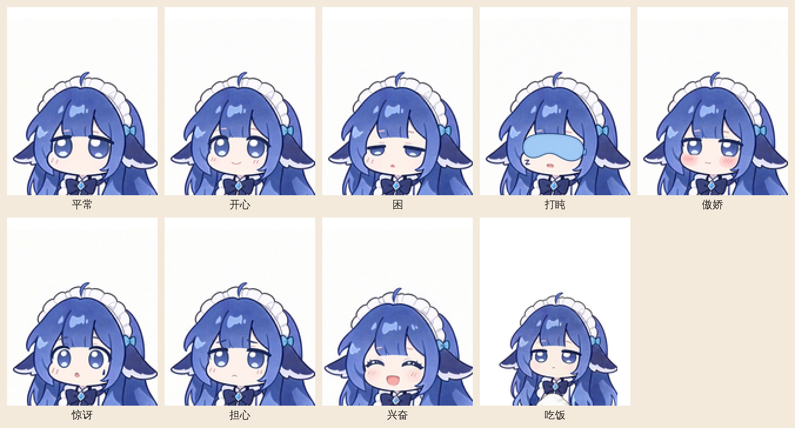

# 大肥鱼

ESP32-C3 上的桌面陪伴小人。1.8 寸屏幕里是一个蓝发少女，平时看时间、天气和日期，挥一下手会跟你说话，按时间、气温和天气换表情。

「大肥鱼」是中文网友给 DeepSeek 起的外号。这个桌宠用的是同一套人设：蓝头发，爱吃白饭，总是困困的，温柔，有一点傲娇。它不是 DeepSeek 的官方产品。



当前版本是 **v1.0**。可以直接刷 [`releases/v1.0/`](releases/v1.0/)，也可以用 ESP-IDF 自己编译。

## 它会做什么

- 上方一张卡片：大号时钟、天气图标、气温、日期。挥手后弹出一句椭圆气泡，大约 7 秒。
- 手在超声波前挥一下算一次。1 到 10 秒内再挥一次，气泡里用大号数字显示 DeepSeek 余额。
- 九个表情循环：平常、开心、困、打盹、傲娇、惊讶、担心、兴奋、吃饭。打盹才戴眼罩。吃饭是捧着一碗白饭，饭点会换上这张脸。默认仍是一张不动的经典立绘，在设置页或串口里打开表情。
- 空闲时按时间、气温、天气换脸，一张脸保持大约一分钟。深夜很久没人动会打盹，下雨或天冷偏担心，饭点换吃饭。
- 句子按时段和天气挑选。内置 20 句，快说完时用自己的 DeepSeek 密钥向 `deepseek-flash` 再要 20 句。每天最多 4 次，两次至少隔 12 小时。密钥只存在板上，不在固件里。
- 喝水、久坐提醒，生日当天的蜡烛和烟花，连不上 Wi-Fi 时自己开一个配网热点。设置页在 `http://pet.local/`。
- 天气、余额和设置存在 NVS。断电再上电还在。网络失败时留下上次的天气，不会改成「天气失败」。

行为细节、串口命令和人设提示词在 [firmware/idf/README.md](firmware/idf/README.md)。

## 硬件

主控是 ESP32-C3 Super Mini，4MB 闪存。屏幕是 ST7735，128×160。测距是 HC-SR04，ECHO 必须是 3.3V，5V 回波会损坏引脚。

下面是 **v1.0 固件** 的接线。v0.1 裸机程序的 MOSI、DC 不同，不要混用。

| 模块 | 信号 | GPIO |
|---|---|---:|
| 屏幕 | SCK | 4 |
| 屏幕 | MOSI | 9 |
| 屏幕 | CS | 10 |
| 屏幕 | DC | 8 |
| 屏幕 | RST | 3 |
| HC-SR04 | TRIG | 7 |
| HC-SR04 | ECHO | 6 |
| 两个模块 | GND | GND |

屏幕按模块规格接 3.3V。HC-SR04 按模块规格供电。

## 刷机

先备份整片闪存。不要整片擦除，Wi-Fi 和设置在 `0x9000`。

```sh
python3 -m esptool --chip esp32c3 --port /dev/cu.usbmodem1101 read-flash 0x0 0x400000 original-flash.bin
```

三个都要写：分区表、应用、表情包。文件在 `releases/v1.0/`。

```sh
python3 -m esptool --chip esp32c3 --port /dev/cu.usbmodem1101 -b 460800 \
  --before default_reset --after hard_reset write-flash \
  --flash-mode dio --flash-size 4MB --flash-freq 40m \
  0x8000 releases/v1.0/partition-table.bin \
  0x10000 releases/v1.0/companion-v1.0.bin \
  0x190000 releases/v1.0/assets-v1.0.bin
```

串口 115200。起来之后会打印 `PET READY v1.0`，以及 `assets ok v20261116 clips 9/9 frames 216`。看到 `assets missing` 就是分区表没写上。

应用大约 1.38MB，放在从 `0x10000` 开始的 1.5MB 槽里。表情包大约 912KB，放在从 `0x190000` 开始的 2MB 分区里。这次多了吃饭，应用和表情包要一起刷。

## 自己编译

联网版在 [`firmware/idf`](firmware/idf)，用 ESP-IDF 5.4。

```sh
cd firmware/idf
idf.py set-target esp32c3
idf.py build
```

重做表情包需要原来的视频、ffmpeg 和 Pillow：

```sh
python3 tools/gen_expressions.py
```

脚本读 `assets/expressions/videos/` 里的原片，抽出 24 帧，裁掉头顶空白，打成 `firmware/idf/assets.bin`。`videos/cropped/` 是裁好的预览，不能刷进芯片。

v0.1 是不联网的裸机程序，构建方式见 [`releases/v0.1/`](releases/v0.1/)。

## 仓库里有什么

| 路径 | 内容 |
|---|---|
| `firmware/idf/` | 当前固件，ESP-IDF 工程 |
| `firmware/` | v0.1 裸机程序 |
| `releases/v1.0/` | 可刷的应用、分区表、表情包、校验 |
| `assets/expressions/videos/` | 表情原片，以及裁过的预览 |
| `tools/` | 字库、表情包和 v0.1 的构建脚本 |
| `docs/v1.0-roadmap.md` | 做 v1.0 之前写的目标和后来改掉的地方 |

## 许可

本仓库用 [MIT 许可证](LICENSE)。

另外三份代码和字体沿用它们自己的许可，不因为本仓库的 MIT 而改变：

- `firmware/idf/main/tjpgd.c`：ChaN 的 TJpgDec R0.03，版权声明在文件头
- `assets/fonts/NotoSansCJKsc-Regular.otf`：SIL Open Font License，见 `assets/fonts/OFL.txt`
- ESP-IDF 及其组件：各自的许可证
